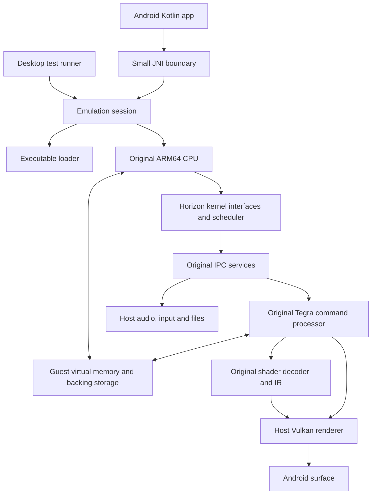

# Original emulator architecture

Design baseline: 2026-10-30. This document defines the system boundaries;
[design.md](design.md) defines the runtime contracts, and
[implementation-plan.md](implementation-plan.md) defines delivery order and
acceptance gates. Proposed components below are not claims of implemented
functionality. Implemented now: bounded static NRO loading, the small A64
interpreter, handles, HIPC/CMIF v0, cloned sessions, event polling and CLI
sessions. Android embeds the same Rust engine for four original guest checks
alongside the Vulkan laboratory. The user
supplied a physical G720 0.3.0-dev report passing all six current workloads,
including BC1 conversion, sampling and updates. Guest graphics and Android
presentation remain unimplemented.
An original Rust BC1
reference decoder is implemented separately from guest GPU emulation.

## Scope

Implement our own emulation logic, starting with Switch 1 and Android on the
Realme GT 7 Dream Edition / Immortalis-G720. Existing emulator cores are not
the implementation base. General-purpose tooling and future libraries for
Vulkan bindings, audio or Android interoperation are separate from emulation
engines; select them when their corresponding module is implemented.

This is a long-term systems project. A small A64 interpreter is its first
executable foundation. It provides no present claim of Switch game support.
Pokémon Legends: Z-A remains a later acceptance target after CPU, loader,
kernel/services, GPU, audio and input are sufficiently implemented.

We will implement a user-mode emulator with our own high-level implementation
of the guest operating-system interfaces. We will not require booting the
original console firmware or reproducing every physical component before
running a small homebrew program. CPU instructions, visible kernel/service
behavior and the GPU workloads that the guest submits still require original
implementations with accurate observable behavior.

## Runtime architecture



The Android app manages the library and lifecycle. It does not execute guest
instructions, marshal frame pixels through Kotlin, or implement GPU commands.
The session composes the engine and host adapters. CPU execution returns to
the scheduler at explicit boundaries; GPU submission and completion are
separate events rather than a universal `runFrame()` loop.

## Technology choices

| Component | Initial choice | Reason |
| --- | --- | --- |
| Original emulation logic | Rust | Typed guest addresses, checked parsers, ownership and testability |
| Android application | Kotlin; Compose planned for the gameplay application | The current GPU Lab uses basic native Android views |
| Host rendering | Vulkan; evaluate Rust `ash` bindings | Explicit capabilities and synchronization; bindings are not an emulator core |
| Guest shader translation | Our decoder, typed IR, lowerings and SPIR-V emission | Own guest semantics and feature fallbacks |
| Shader verification | SPIR-V validation tools | Detect invalid generated modules before driver submission |
| Android audio | Oboe through a small native adapter | Device-aware low-latency output without routing samples through the UI |
| Library metadata | Room/SQLite, separate from guest saves | Search/import metadata must not own emulated filesystem semantics |
| Build/test | Cargo, Gradle/NDK, LLVM fixtures | Reproducible host tests and Android packages |

Generic bindings, assemblers and audio libraries may be used; an existing
emulator CPU/GPU/HLE engine may not. Dependencies will be pinned when added.
The current workspace has no external crate dependencies. Core crates keep
`unsafe_code = forbid`; the current Android boundary permits the exported-symbol
attribute only, with no unsafe blocks or raw-pointer arguments. Future Vulkan/JIT boundary crates must isolate and
document the unsafe operations those interfaces require rather than weakening
that rule across the entire engine.

The JNI surface will carry session commands, input batches, surface changes
and compact status reports. Audio/video buffers remain native. This follows
Android's recommendation to minimize marshalling and JNI traffic.
[Android JNI guidance](https://developer.android.com/ndk/guides/jni-tips)

## Dependency direction

- `a64` and `loader` use guest memory; the CPU does not depend on the kernel.
- `kernel` owns service-dispatch contracts and guest scheduling. Concrete
  service implementations are registered by the session, avoiding a
  kernel-to-services-to-kernel dependency cycle.
- `gpu` owns backend-neutral commands and completion contracts. It does not
  depend on Vulkan. `renderer-vulkan` implements those contracts.
- `shader` does not depend on Android or the game library.
- `session` is the composition root. Android and CLI hosts both use it.

Only implemented crates are added to the workspace. The planned layout is:

```text
crates/
  memory/             implemented guest memory
  a64/                implemented interpreter subset
  cli/                implemented NRO/raw-program runner
  loader/             implemented static NRO subset
  ipc/                implemented bounded HIPC/CMIF v0 subset
  kernel/             implemented SVCs, handles, cloned sessions and event polling
  services/           implemented minimal SM and emulator-owned diagnostic service
  shader/             planned original GPU shader decoder / IR
  gpu/                planned guest commands and GPU address space
  renderer-vulkan/    planned host backend
  session/            implemented single-process bounded execution
  texture/            implemented linear BC1 RGBA UNORM reference decoding
  android-ffi/        implemented reference-program C ABI; gameplay API planned
android/
  app/                planned user application
  gpu-lab/            four guest checks plus six host GPU checks; presentation planned
native/
  gpu-lab/            implemented host-only C++ Vulkan workload runner
examples/
  homebrew/           four implemented original static NRO fixtures
tests/
  gpu-workloads/      planned command, shader and reference-image tests
```

## Module boundaries

| Layer | Responsibility | Current state |
| --- | --- | --- |
| Guest memory | Guest addresses, ownership, access checks; later shared backing/aliases | Bounded transactional mappings, reservation/commit/protect/unmap and cross-region accesses implemented |
| CPU | A64 registers, decode/execute, exceptions/SVC boundary; later SIMD/atomics/JIT | Small tested interpreter subset |
| Loader | Validate executable bounds/segments and construct guest process | Static uncompressed NRO0 v0 subset; no linking or modules |
| Kernel | Handles, threads, scheduling, events, address-space operations, SVCs | Handles, transactional IPC, cloned sessions, manual-reset events and polling; scheduling/blocking waits planned |
| Services | Horizon IPC and needed filesystem/display/GPU/audio/input services | CMIF v0 SM Initialize/GetService for `emu:test`; system device services planned |
| Guest GPU | Tegra command decoding, GPU addresses, draw/compute state and shader translation | Planned |
| Host graphics | Vulkan resource lifetime, formats, pipelines, barriers and Android presentation | Six offscreen native workloads, including BC1 conversion, sampling and updates; guest backend/presentation planned |
| Android host | Lifecycle, surface, input, audio and diagnostics | Engine reference checks, GPU Lab and JSON export implemented; gameplay integration planned |
| CLI | Bounded interpreter execution with explicit unsupported-operation errors | Implemented |

Share generic infrastructure when future consoles need it, but keep their CPU,
loader, operating-system and hardware semantics separate. Do not force every
console into an assumed fixed-size frame callback.

## CPU and memory correctness

Begin with an interpreter so each instruction's behavior can be tested before
adding a recompiler or native-execution mode. An ARM64 phone still needs the
guest operating-system and hardware environment; sharing an instruction-set
family does not supply those systems.

Current guest memory is owned byte storage rather than host pointers. Regions
have independent read/write/execute permissions. Instructions fetch aligned
32-bit little-endian words; supported data operations allow unaligned access.
An access may cross adjacent mappings after checking the complete range.
Writes preflight all permissions before mutation. There is no page-table/MMU
model, shared backing/alias model, SP alignment-control model, exclusive
monitor, guest threading or privileged exception state yet.

SVC produces a host-visible event after advancing the guest PC. The NRO
session dispatches the [implemented SVC/IPC subset](kernel-ipc.md); the raw harness
reports the event. Unsupported calls fail explicitly. Unknown instructions
and memory faults preserve the instruction's prior CPU state.

The raw CLI maps a fixed test-only layout. The NRO session has its own
documented [process layout and entry ABI](nro-loader.md). Real Switch userspace has separately
managed executable, heap, mapping and stack regions; the loader/kernel must
eventually model the guest process requirements independently of the host OS.
[Public memory-layout research](https://www.switchbrew.org/wiki/Memory_layout)

## Mali graphics strategy

Build our own guest command decoder and shader path, with a host Vulkan
backend based on queried device capabilities. Do not assume a global Vulkan
version, a GPU brand or successful Android presentation proves compatibility.

Query individual format capabilities and the exact image usage/type/creation
requirements. Start with a correct supported uncompressed fallback for guest
formats the host cannot sample, then investigate compressed representations
as an optimization. Preserve original guest data for copies and readbacks.
[Khronos format documentation](https://docs.vulkan.org/guide/latest/formats.html)

Keep a shader translation layer with explicit feature requirements. Lower
unsupported guest operations where feasible; otherwise return a clear
unsupported-path diagnostic. Missing stages such as geometry/tessellation
cannot be fixed merely by claiming their Vulkan features are available.

Treat synchronization and resource lifetime as correctness requirements:
ordered copies, compute-to-draw visibility, valid image layouts, cache
coherence and safe reclamation. Add driver workarounds only after a reduced
workload demonstrates the exact issue. Budget guest data, converted images,
staging allocations and shader/pipeline caches together.

Keep two graphics milestones distinct: a native Android Vulkan workload
validates our host backend on the G720, while an emulated guest workload must
also exercise guest commands, memory, shaders and service interactions.

## Validation ladder

CPU/loader work and host graphics feasibility begin as two independent tracks.
The proof levels below express what each result establishes, not a requirement
to finish every CPU instruction before testing Mali graphics.

1. Original assembly microprograms checked with an independent assembler;
   verify registers, flags, memory, branching and deterministic faults.
2. An original small executable loader with malformed/truncated input tests.
3. Homebrew debug output through implemented guest services.
4. Physical Android Vulkan workloads exercising formats, copies, shaders and
   synchronization, with screenshots/readbacks and device/driver records.
5. Guest graphics homebrew reaching our GPU emulation and host presentation.
6. Audio/input, larger service coverage, real-device stability and performance.
7. Commercial game testing, including Z-A, with specific reproducible scenes.

Do not report a passing early stage as evidence that a later stage works.

## Long-term multi-console support

The common session interface exposes load/start/pause/resume/stop, typed input,
audio/video attachment and capability discovery. Each console retains its own
CPU, loader, operating-system/hardware model and timing. Save states, rewind,
multiplayer and multiple screens are optional capabilities. Do not route Game
Boy or PSP through Switch-specific services, or build a multi-core download
system before the first original console engine works.

No account or backend service is required for the first application. Library,
settings, saves and reports stay local. Ordinary in-game saves precede full
emulator save states, which require a coherent snapshot of CPU, kernel,
services and GPU resources.

## Initial instruction reference

Instruction fixtures are our own assembly programs assembled by LLVM; their
bytes are not generated by our decoder. The initial supported forms follow
public A64 instruction semantics, including W-register zero extension and
MOVZ's width-dependent shifts.
[Arm MOVZ reference](https://support.arm.com/documentation/dui0801/j/A64-General-Instructions/MOVZ)
