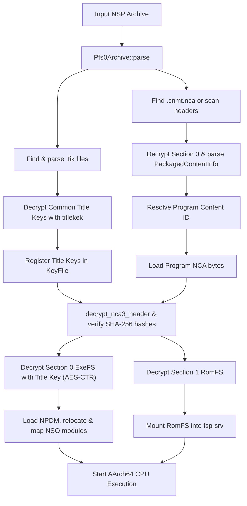

# NSP Package & Decryption Specification

## 1. Overview & Clean-Room Invariants

Nintendo Switch commercial software (including *Pokémon Legends: Z-A*) is typically distributed or dumped as Nintendo Submission Package (`.nsp`) files.

This specification documents the clean-room implementation of:
1. **NSP Archive Parsing**: PFS0 (Partition FileSystem) container parsing extracting packaged NCAs, tickets, certificates, and metadata XMLs.
2. **Ticket Decryption Engine (`.tik`)**: Binary ticket parser handling RSA-2048, RSA-4096, and ECDSA signature headers, parsing Rights IDs, and decrypting Common AES-128 title keys using `titlekek` via AES-128-ECB.
3. **CNMT (Content Meta) Parser**: Decrypting and parsing `PackagedContentMeta` records from `.cnmt.nca` to reliably map Content IDs to content types (`Program`, `Control`, `LegalInformation`).
4. **Session Integration**: `Session::from_nsp` integrating ticket unwrapping, Program NCA identification, NCA header XTS decryption, ExeFS AES-128-CTR decryption, RomFS mounting into `fsp-srv`, and Horizon OS program initialization.
5. **Decryption Workflows**: Matching standard emulator key conventions (`prod.keys`, `title.keys`, embedded NSP tickets) with secret redaction and memory sanitization.

---

## 2. NSP File System Hierarchy

An NSP is structurally a standard PFS0 partition archive containing:
```
<nsp_archive.nsp>
├── <rights_id>.tik                   (Optional Ticket containing encrypted title keys)
├── <rights_id>.cert                  (Optional Certificate chain)
├── <title_id>.cnmt.xml               (Optional human-readable metadata XML)
├── <content_id_meta>.cnmt.nca        (Meta NCA containing binary PackagedContentMeta)
├── <content_id_prog>.nca             (Program NCA containing ExeFS and RomFS)
└── <content_id_ctrl>.nca             (Control NCA containing NACP and icons)
```

### 2.1. PFS0 Partition Format
PFS0 stores:
- 16-byte header: magic (`PFS0` / `HFS0`), `num_files: u32`, `string_table_size: u32`, `reserved: u32`.
- Array of file entries (24 bytes each): `data_offset: u64`, `size: u64`, `string_table_offset: u32`, `reserved: u32`.
- UTF-8 null-terminated string table.
- Raw file data streams.

Implemented in [`crates/loader/src/pfs0.rs`](file:///root/projects/emulator/crates/loader/src/pfs0.rs) and wrapped by [`crates/loader/src/nsp.rs`](file:///root/projects/emulator/crates/loader/src/nsp.rs).

---

## 3. Nintendo Switch Ticket (`.tik`) Decryption

Tickets authorize content execution by binding an encrypted 128-bit Title Key to a 128-bit Rights ID.

### 3.1. Ticket Binary Layout
A ticket file consists of a signature header followed by a `TicketData` structure:

| Offset (Ticket Data) | Size | Field | Description |
|---|---|---|---|
| `0x000` | `0x040` | `issuer` | Null-terminated issuer string (e.g. `Root-CA...`) |
| `0x040` | `0x100` | `title_key_block` | Encrypted title key block (first 16 bytes for common tickets) |
| `0x140` | `0x001` | `format_version` | Format version (typically 2 for Switch) |
| `0x141` | `0x001` | `title_key_type` | `0` = Common TitleKey (AES-128), `1` = Personalized (RSA-2048) |
| `0x145` | `0x001` | `master_key_revision` | Key generation index for `titlekek` selection |
| `0x150` | `0x008` | `ticket_id` | 64-bit Ticket ID |
| `0x158` | `0x008` | `device_id` | 64-bit Device ID |
| `0x160` | `0x010` | `rights_id` | 128-bit Rights ID matching NCA header `rights_id` |
| `0x170` | `0x004` | `account_id` | 32-bit Account ID |

### 3.2. Common Title Key Decryption Algorithm
For Common Tickets (`title_key_type == 0`):
1. Extract the 16-byte ciphertext from `title_key_block[0x00..0x10]`.
2. Look up the Title Key Encryption Key (`titlekek_<master_key_revision:02x>`) from `KeyFile`.
3. Decrypt the block using AES-128-ECB:
   $$\text{TitleKey} = \text{AES-128-ECB-Decrypt}(\text{titlekek}, \text{EncryptedKey})$$
4. Register the resulting plaintext 16-byte Title Key in `KeyFile` under both `titlekey_<rights_id_hex>` and bare `<rights_id_hex>`.

Implemented in [`crates/loader/src/ticket.rs`](file:///root/projects/emulator/crates/loader/src/ticket.rs).

---

## 4. CNMT (Packaged Content Meta) Engine

The CNMT file describes the exact constituent NCAs comprising a Switch title.

### 4.1. Meta NCA Section Decryption
The Meta NCA (`.cnmt.nca`) has `content_type == 1` (`NcaContentType::Meta`).
- Its header is decrypted with `header_key` via AES-128-XTS.
- Section 0 is a `PartitionFs` (PFS0).
- Section 0 payload is decrypted (if encrypted) and parsed as a PFS0 archive.
- The `.cnmt` binary inside Section 0 is extracted and parsed.

### 4.2. PackagedContentInfo Records
The `.cnmt` binary contains:
- `PackagedContentMetaHeader` (32 bytes): `title_id: u64`, `version: u32`, `meta_type: u8`, `ext_header_size: u16`, `content_count: u16`.
- Array of `PackagedContentInfo` records (56 bytes each):
  - `0x00..0x20`: SHA-256 hash of the content NCA.
  - `0x20..0x30`: 128-bit Content ID. The corresponding file in the NSP is `<content_id_hex>.nca`.
  - `0x30..0x36`: 48-bit content byte size.
  - `0x36`: `ContentType` (`0` = Meta, `1` = Program, `2` = Data, `3` = Control, `5` = LegalInformation).

From these records, `NspArchive::find_program_nca()` precisely resolves the Program NCA by Content ID. If CNMT is absent, it seamlessly falls back to inspecting decrypted NCA headers.

Implemented in [`crates/loader/src/cnmt.rs`](file:///root/projects/emulator/crates/loader/src/cnmt.rs).

---

## 5. End-to-End Program Bootstrapping (`Session::from_nsp`)



---

## 6. CLI & Tooling Usage

The emulator CLI supports running `.nsp` packages directly:
```bash
# Run NSP with automatic key discovery
cargo run -p emulator-cli -- run-nsp /path/to/game.nsp

# Run NSP with explicit prod.keys and title.keys
cargo run -p emulator-cli -- run-nsp /path/to/game.nsp --keys /path/to/prod.keys --titlekeys /path/to/title.keys --max-steps 500000
```
