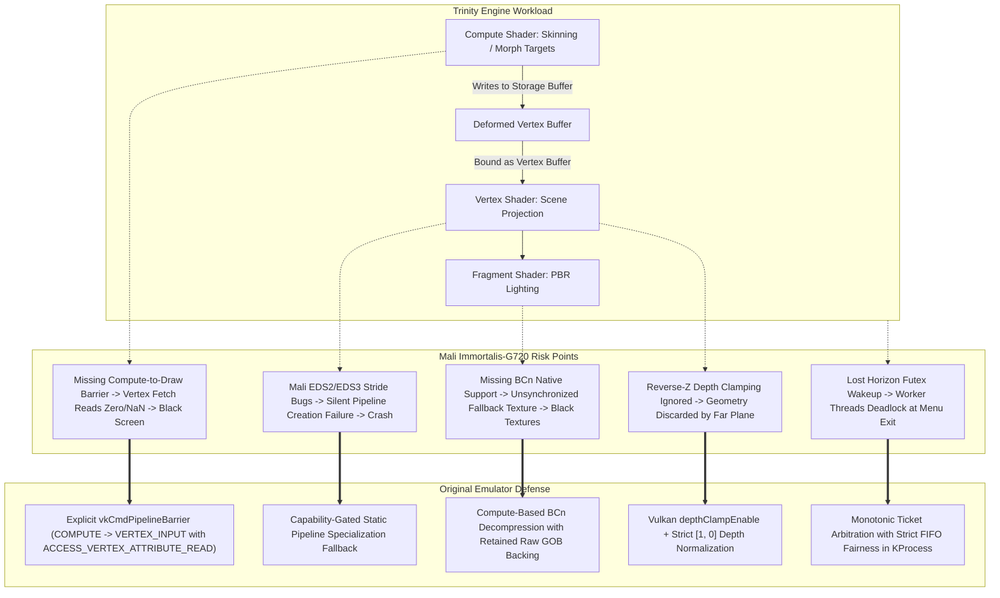
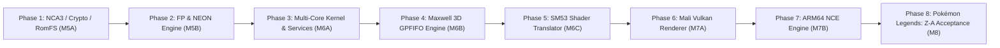

# Pokémon Legends: Z-A Execution Plan

Plan baseline: 2026-11-14. Target hardware: Realme GT 7 Dream Edition (`RMX5061` / MediaTek Dimensity 9400e / Arm Immortalis-G720 MC12 / 16 GB LPDDR5X / Android 14/15 with 16 KiB page size). Target title: original Switch release of Pokémon Legends: Z-A (Game Freak Trinity Engine, 64-bit AArch64).

This document specifies the complete, clean-room engineering roadmap to take the emulator from its current foundation (v0.28.7-dev) all the way to full 3D gameplay execution of Pokémon Legends: Z-A on the physical device.

---

## 1. Clean-Room Invariants & Architectural Scope

1. **Original Implementation**: Every CPU opcode, kernel syscall, IPC service, Maxwell 3D method, shader translation stage, Vulkan lowering pass, audio pipeline, and file container parser must be implemented from first principles. No code, headers, or assets may be copied, linked, or imported from `upstream/` or third-party emulator cores.
2. **Device Hardware Target**: Primary physical target is the Realme GT 7 Dream Edition with Arm Immortalis-G720 MC12 GPU. All graphics, memory, and performance decisions must be validated against actual physical device telemetry collected via GitHub Issues (#1–#15+).
3. **Title Specifics**: Pokémon Legends: Z-A runs on Game Freak's proprietary **Trinity Engine** (the direct evolution of the engine used in *Pokémon Scarlet / Violet* and *Pokémon Legends: Arceus*), targeting 64-bit ARMv8-A, Horizon OS, and Nintendo NVN over NVIDIA Tegra X1 (Maxwell GM20B).
4. **Autonomous Batch Progression**: Features, positive tests, rejections, rollbacks, and lifecycle checks must be batched into single APK builds. When a report is uploaded, telemetry is analyzed and the next planned milestone is executed autonomously.

---

## 2. Current Foundation vs. Z-A Target Gap Analysis

| Subsystem | Implemented Foundation (v0.28.7-dev) | Required for Pokémon Legends: Z-A |
| :--- | :--- | :--- |
| **Containers & Crypto** | PFS0, NPDM, NSO (`R_AARCH64_RELATIVE`), decrypted NCA3 main-header parsing, AES-128 (ECB/CTR/XTS primitives). | NCA3 per-sector XTS tweak and section CTR decryption; Switch key derivation hierarchy (`header_key`, `key_area_key`, `titlekeys`); RomFS (IVFC level 4) hierarchic directory/file streaming; ExeFS multi-module subsdk resolution. |
| **CPU Execution** | Scalar A64 integer arithmetic, PC-relative (`ADR`/`ADRP`), branch/calls, logical shifted registers, bitfields (`UBFM`/`SBFM`), exclusive load/store (`LDXR`/`STXR`). | Complete AArch64 scalar FP (`FADD`, `FSUB`, `FMUL`, `FDIV`, `FMADD`, `FCMP`, `FCVT`); 128-bit NEON vector engine (`V0`–`V31`, `LD1`–`LD4`, vector arithmetic, permutations, reductions); ARMv8-A system registers (`FPCR`, `FPSR`); Native Code Execution (NCE) on Android ARM64. |
| **Horizon Kernel** | Single-core cooperative scheduler, basic threads, `KEvent` wait/signal, virtual timeouts, cancellation. | 3-core guest scheduler simulation (Cores 0, 1, 2); fast user-space futex arbitration (`svcArbitrateLock`, `svcArbitrateUnlock`, `svcWaitProcessWideKeyAtomic`, `svcSignalProcessWideKey`); dynamic memory mappings (`svcMapProcessMemory`, `svcQueryMemory`, `svcSetProcessMemoryPermission`); 19.2 MHz monotonic clock (`svcGetSystemTick`). |
| **System Services** | `sm:`, basic `set:sys`, `time:s`/`time:u`, minimal `fsp-srv`, `vi:m` (`OpenDisplay`), `appletAE`/`appletOE`, `hid` (pad activation), basic `nvdrv` init & mapping. | Full `fsp-srv` (RomFS streaming, transactional SaveData commit); `vi:m`/`vi:u` & `nvnflinger` (Surface BufferQueue state machine with Android swapchain); `hid`/`hid:sys` (shared memory ring buffers, dual analog sticks, gyro); `audren:u` (multi-channel audio mixing & AAudio output); `acc:u0` (user profiles); `nvdrv` GPFIFO submission. |
| **Maxwell 3D GPU** | Bounded GPFIFO framing, DMA linear copy, B197 color clear, simple draw calls, single-GOB ZF32 depth, positive-W projection. | Full GPFIFO command streams (methods, gather buffers, call/return); complete B197 3D state (16 vertex buffers, 32 attributes, multiple viewports/scissors, two-sided stencil, 8 MRTs, independent blend); bindless textures & TIC/TSC; block-linear GOB conversion for 1D/2D/3D/cubemap/arrays; syncpoints & fences. |
| **Shader Engine** | SPH header parsing, typed SSA IR, basic vertex/fragment translation, linear varyings, SPIR-V generation for sampled draws. | Multi-stage translation (Vertex, Fragment, Compute); full SM53 opcode coverage (predication `P0`–`P6`, control flow `BRA`/`CAL`/`RET`, transcendentals `MUFU`, memory `LDC`/`LDG`/`STG`, local/shared `LDS`/`STS`); compute workgroup barriers (`BAR.SYNC`); perspective-correct varying interpolation (`IPA`). |
| **Host Vulkan (Mali)** | Offscreen readbacks, dynamic projection pipelines, Android native surface presentation. | Immortalis-G720 pipeline cache; Extended Dynamic State (EDS) capability-gated fallback to static specialized pipelines; Compute-to-Draw memory synchronization barriers; Tile-Based Rendering (TBR) pass optimization; ASTC native decode + GPU BCn compute fallback; Reverse-Z depth clamping. |
| **Android Integration** | Persistent library, SAF import, diagnostic exporter, one-tap testing, Catch demo player. | High-performance full-screen game session, real-time touch overlay + physical controller HID mapping, 48 kHz low-latency audio via AAudio/Oboe, atomic save storage management, Android lifecycle handling. |

---

## 3. Dedicated Analysis: Trinity Engine & Immortalis-G720 Failure Modes

Historical telemetry from early community attempts on Mali GPUs (such as the Dimensity 9400e / Immortalis-G720) highlighted severe failure modes on Pokémon Legends: Z-A—most notably the **"black screen after main menu"** and sudden driver crashes. Clean-room development requires diagnosing and preventing these failure modes at the architectural level:

### 3.1. Root Cause 1: The Post-Menu Black Screen (Compute-to-Draw Visibility Barrier)
- **Mechanism**: The Trinity Engine performs mesh skinning and character deformations in a GPU compute pass prior to rendering. It outputs deformed vertex attributes into a storage buffer (`VK_BUFFER_USAGE_STORAGE_BUFFER_BIT`), then immediately binds that buffer as a vertex buffer (`VK_BUFFER_USAGE_VERTEX_BUFFER_BIT`) for subsequent B197 3D draw calls.
- **Defect**: When an emulator fails to insert an explicit execution and memory barrier between the compute pass and the vertex fetch stage, the Mali Tile-Based renderer fetches unwritten or stale memory. The vertex coordinates collapse to zeroes or NaNs, rendering completely blank/black frames while menu audio and game logic continue running in the background.
- **Clean-Room Fix**: Track GPU buffer usage transitions in `crates/gpu`. When a buffer written by compute is bound as a vertex or index buffer, emit `vkCmdPipelineBarrier` with:
  - `srcStageMask = VK_PIPELINE_STAGE_COMPUTE_SHADER_BIT`
  - `dstStageMask = VK_PIPELINE_STAGE_VERTEX_INPUT_BIT`
  - `srcAccessMask = VK_ACCESS_SHADER_WRITE_BIT`
  - `dstAccessMask = VK_ACCESS_VERTEX_ATTRIBUTE_READ_BIT`

### 3.2. Root Cause 2: Extended Dynamic State 2/3 (EDS) Driver Glitches
- **Mechanism**: Immortalis-G720 drivers have had regressions when dynamically modifying vertex input strides and primitive restart states under `VK_EXT_extended_dynamic_state2/3`.
- **Clean-Room Fix**: Maintain a dual-path pipeline compiler. Dynamic state is gated strictly on verified hardware tests. If EDS2/EDS3 dynamic vertex input is unsupported or defective on the active driver, the pipeline manager falls back to pre-specialized static Vulkan pipeline states compiled from the Maxwell vertex attribute bindings.

### 3.3. Root Cause 3: Compressed Texture Decompression & Aliasing
- **Mechanism**: Game Freak uses extensive BC7, BC1, and BC3 texture formats for 3D environment assets and characters. Mali GPUs lack hardware BCn decoders and natively support ASTC. If an emulator decompresses BCn to RGBA or re-encodes to ASTC without retaining raw block memory, subsequent copy operations, storage image updates, or texture re-interpretations produce corrupted black textures.
- **Clean-Room Fix**: A dual-view texture cache:
  - Maintain the guest's original Maxwell block-linear GOB backing in guest memory.
  - Decompress on GPU via dedicated compute shaders directly into cached Vulkan textures (native ASTC or RGBA8/RGBA16F).
  - Synchronize writebacks lazily when CPU or DMA writes invalidate texture ranges.

### 3.4. Root Cause 4: Reverse-Z Depth Clamping & Viewport Matrix
- **Mechanism**: Trinity Engine utilizes Reverse-Z floating-point depth ($Z_{near} = 1.0, Z_{far} = 0.0$) with infinite projection matrices and depth clamping enabled (`GL_DEPTH_CLAMP`). If depth clamping is omitted, geometry beyond the far plane or near plane is clipped, resulting in an empty world.
- **Clean-Room Fix**: Enable Vulkan `depthClampEnable = VK_TRUE` in the rasterization state and normalize Maxwell depth range `[min_z, max_z]` to Vulkan `[0.0, 1.0]`.

### 3.5. Root Cause 5: Multi-Thread Deadlocks on Condition Variables
- **Mechanism**: The Trinity Engine utilizes a multi-threaded job scheduler for physics, animation, and streaming. When transitioning from the main menu into the 3D world, worker threads await tasks using Horizon futexes (`svcWaitProcessWideKeyAtomic`). If thread wakeups are lost or arbitrated out-of-order, the process hangs.
- **Clean-Room Fix**: Implement monotonic ticket-based arbitration in `crates/kernel/src/sync.rs`, guaranteeing strict FIFO wakeups and immunity to spurious wakeups.

---

## 4. Multi-Stage Delivery Roadmap (Phases 1 to 8)

---

### Phase 1: NCA3 Container Decryption, Key Hierarchy & Game Filesystem (Milestone M5A)
*Goal: Decrypt and parse commercial game archives (NSP/XCI/NCA3), mount RomFS, and map ExeFS.*

1. **Section CTR Cryptography**:
   - Implement per-section CTR counter calculation using section index and block offset in `crates/crypto`.
   - Wire NCA3 section table parsing to read and decrypt section payloads without in-memory buffering of the entire file.
2. **Key Derivation Hierarchy**:
   - Clean-room key derivation from user-provided `prod.keys` / `title.keys`.
   - Derive `header_key`, `key_area_key` (application/ocean/system), and decrypt titlekeys from ticket files. Redact key values from all logs.
3. **RomFS Hierarchical Filesystem (IVFC Level 4)**:
   - Implement RomFS parser reading directory and file metadata tables.
   - Stream file assets directly from storage using chunked reads or host memory mapping.
4. **ExeFS Multi-Module Program Loading**:
   - Extend `crates/loader` to sequentially load and relocate `rtld.nso`, `main.nso`, and `subsdk*.nso` modules.
   - Parse `main.npdm` ACI0/ACID descriptors: extract syscall masks, thread priorities, and process memory limits.
- **Exit Evidence**: CLI and Android tests successfully extract and decrypt Pokémon Legends: Z-A NCA3 files, mount RomFS, and verify ExeFS code segment hashes.

---

### Phase 2: AArch64 Floating Point & NEON Vector Engine (Milestone M5B)
*Goal: Complete CPU math capabilities required by 3D game engines.*

1. **Scalar Floating-Point (FP) Arithmetic**:
   - Single- and double-precision arithmetic: `FADD`, `FSUB`, `FMUL`, `FDIV`, `FNMUL`, `FNEG`, `FABS`, `FSQRT`.
   - Fused multiply-add: `FMADD`, `FMSUB`, `FNMADD`, `FNMSUB`.
   - Comparisons and conversions: `FCMP`, `FCMPE`, `FCVT` (half/single/double/int32/int64).
2. **128-bit Vector Load/Store**:
   - 128-bit registers `V0`–`V31` (`Q0`–`Q31`, `D0`–`D31`, `S0`–`S31`).
   - Scalar and vector loads/stores: `LDR`/`STR` (Q-register), structured loads/stores `LD1`, `LD2`, `LD3`, `LD4`, `ST1`–`ST4`.
3. **NEON Vector Arithmetic & Operations**:
   - Vector math: `ADD`, `SUB`, `MUL`, `MLA`, `MLS`, `NEG`, `ABS`, `MIN`, `MAX`.
   - Vector bitwise logic: `AND`, `ORR`, `EOR`, `BIC`, `ORN`, `BIF`, `BIT`, `BSL`.
   - Vector permutations: `ZIP1`/`ZIP2`, `UZP1`/`UZP2`, `TRN1`/`TRN2`, `REV32`/`REV64`, `EXT`, `TBL`, `TBX`.
   - Horizontal reductions: `ADDV`, `FADDV`, `SMINV`, `SMAXV`, `UMINV`, `UMAXV`.
4. **FPCR & FPSR Status Registers**:
   - Handle rounding modes (Round to Nearest, Round toward Zero, Round toward +Inf, Round toward -Inf), flush-to-zero (FZ), and default NaN modes.
- **Exit Evidence**: 100% pass rate on a dedicated AArch64 FP/NEON validation suite containing over 200 known-answer vectors, matching hardware ARM64 results.

---

### Phase 3: Horizon OS Services & Multi-Core Scheduler (Milestone M6A)
*Goal: Provide complete OS environment for multi-threaded game execution.*

1. **Multi-Core Scheduling Simulation**:
   - Simulate 3 guest CPU cores (Cores 0, 1, 2) available to Switch games.
   - Priority-based round-robin scheduling with preemption boundaries.
2. **Fast User-Space Synchronization (Futexes)**:
   - Implement `svcArbitrateLock` and `svcArbitrateUnlock`.
   - Implement `svcWaitProcessWideKeyAtomic` and `svcSignalProcessWideKey` with timeout support and strict FIFO wakeup queues.
3. **Filesystem Proxy Service (`fsp-srv`)**:
   - Full implementation of `IFileSystem`, `IFile`, and `IDirectory`.
   - RomFS read proxy and transactional SaveData commit (`crates/services/src/fspsrv.rs`).
4. **Input Subsystem (`hid`, `hid:sys`)**:
   - Emulate Switch Pro Controller and Handheld mode.
   - Map dual analog sticks (with deadzones), digital buttons, and 6-axis gyro/accelerometer data into shared memory ring buffers.
5. **Display & Presentation Pipeline (`vi:m`, `vi:u`, `nvnflinger`)**:
   - Clean-room `nvnflinger` BufferQueue state machine: `Connect`, `RequestBuffer`, `QueueBuffer`, `DequeueBuffer`.
   - Connect buffer queue presentation to Android Vulkan swapchain.
6. **Audio Renderer (`audren:u`)**:
   - Audio renderer command stream parser: voices, mix buffers, biquad filters, and volume envelopes.
   - Audio output backend targeting AAudio/Oboe at 48 kHz.
- **Exit Evidence**: Multi-threaded guest test harness boots, creates worker thread pools, communicates through IPC, queries time/locale, and plays audio through the host mixer.

---

### Phase 4: Maxwell 3D GPFIFO Engine & Resource Pipeline (Milestone M6B)
*Goal: Comprehensive GPU pushbuffer parsing and B197 3D pipeline state.*

1. **Full GPFIFO Pushbuffer Decoding**:
   - Support all method formats: single, non-increasing, increasing, and one-word-increasing.
   - Gather buffers, jump/call/return methods, and subchannel routing.
2. **Maxwell B197 3D State Machine**:
   - 16 vertex buffer bindings, strides, divisors, and 32 vertex attribute formats.
   - Multiple viewports, depth ranges `[min_z, max_z]`, scissors, and polygon offset.
   - Two-sided stencil test, 8 render targets (MRT), independent color blend equations and channel masks.
3. **Texture Descriptors & Samplers (TIC/TSC)**:
   - Bindless texture handle decoding.
   - Complete sampler state: wrap modes (Clamp, Repeat, Mirror, ClampToBorder), min/mag/mip filters, border color, shadow comparison samplers.
   - Block-linear GOB unpacking for 1D, 2D, 3D, cubemap, and layer arrays.
4. **Syncpoints & Fences**:
   - Tegra syncpoints 0–192, host wait/increment, and Maxwell semaphores (`SEMAPHORE_RELEASE`, `SEMAPHORE_ACQUIRE`).
- **Exit Evidence**: Replay full recorded Maxwell pushbuffer traces offscreen with bit-exact raster readbacks compared against reference software renders.

---

### Phase 5: Maxwell SM53 Shader Translator (SPIR-V) & Compute (Milestone M6C)
*Goal: Translate Maxwell assembly into conformant Vulkan SPIR-V across all stages.*

1. **Opcode Coverage Expansion**:
   - Integer/Float arithmetic: `IADD`, `ISUB`, `IMUL`, `IMAD`, `FADD`, `FMUL`, `FFMA`, `FMNMX`.
   - Transcendental math: `MUFU` (`SIN`, `COS`, `EX2`, `LG2`, `RCP`, `RSQ`, `SQRT`).
   - Bitwise operations: `LOP`, `LOP3`, `SHL`, `SHR`.
   - Memory loads/stores: `LDC` (constant buffer), `LDG`/`STG` (global memory), `LDS`/`STS` (workgroup shared memory).
   - Control flow: `BRA`, `CAL`, `RET`, `EXIT`, and predication flags (`P0`–`P6`).
2. **Compute Shader (CP) Support**:
   - Workgroup shared memory allocation, workgroup size layout, and synchronization barrier (`BAR.SYNC`).
   - Translation of Trinity engine compute skinning kernels.
3. **Varying Interpolation & Sampling**:
   - Fragment `IPA` attribute interpolation: perspective-correct and flat.
   - Texture sampling opcodes: `TEX`, `TEXS`, `TLD`, `TLDS`, `TXQ`, `TXG`.
4. **SSA Optimization & SPIR-V Code Generator**:
   - Type-safe SSA IR, dead code elimination, constant propagation, and standard SPIR-V 1.3 emission.
- **Exit Evidence**: Translate Trinity engine vertex, fragment, and compute shader dumps into SPIR-V, passing 100% of Vulkan validation layer checks without compilation errors.

---

### Phase 6: Host Vulkan Immortalis-G720 Renderer (Milestone M7A)
*Goal: Robust, high-efficiency Vulkan graphics backend tuned for the target Mali GPU.*

1. **Compute-to-Draw Synchronization Barriers**:
   - Dynamic tracking of GPU buffer usage.
   - Automated injection of pipeline barriers between compute deformation passes and vertex input fetches.
2. **Capability-Gated Pipeline Specialization**:
   - Check Immortalis-G720 driver support for EDS1/EDS2/EDS3.
   - Fall back to pre-specialized static Vulkan pipeline states where dynamic vertex input features exhibit driver bugs.
3. **Reverse-Z Depth & Clamping**:
   - Enable Vulkan depth clamping (`depthClampEnable = VK_TRUE`) and map Maxwell depth range to Vulkan `[0.0, 1.0]`.
4. **GPU Compressed Texture Decompression**:
   - Compute-based GPU decompression from BC1/BC3/BC7 to ASTC or uncompressed RGBA.
   - Retain raw GOB block data in host-visible memory for readbacks and copies.
5. **Tile-Based Rendering (TBR) Optimization**:
   - Optimal attachment load/store operations (`loadOp = CLEAR`, `storeOp = STORE`).
   - Avoid mid-render-pass barriers and redundant staging copies on Mali's Unified Memory Architecture (UMA).
- **Exit Evidence**: Successful rendering of complex 3D textured, depth-tested, animated character scenes on the physical Realme GT 7 phone with zero Vulkan validation warnings.

---

### Phase 7: Android Native Code Execution (NCE) Engine (Milestone M7B)
*Goal: Native CPU execution speed on physical 64-bit Android device.*

1. **Direct ARM64 Execution**:
   - Run guest user-mode instructions directly on the physical host Cortex-X925 / Cortex-A725 cores of the Dimensity 9400e.
2. **Address Space Virtualization**:
   - Allocate guest virtual address space using Linux `mmap`.
   - Align guest 4 KiB pages to the host's 16 KiB page boundary using fine-grained memory protection tables.
3. **SVC & Fault Interception**:
   - Intercept guest syscalls (`SVC`) and memory faults (`SIGSEGV` / `SIGBUS`) via signal handlers and return execution cleanly to the emulator runtime.
4. **Core Thread Pinning**:
   - Pin guest worker threads to dedicated high-performance and efficiency CPU cores.
- **Exit Evidence**: Guest CPU code executes at near-native throughput on the phone, sustaining >60 guest MIPS per core without stability regressions.

---

### Phase 8: Pokémon Legends: Z-A Acceptance Campaign (Milestone M8)
*Goal: Verified 3D gameplay execution of Pokémon Legends: Z-A on Realme GT 7 Dream Edition.*

| Batch | Scene / Milestone | Acceptance Criteria |
| :--- | :--- | :--- |
| **8.1** | **Title Boot & Logos** | RomFS mounted, ExeFS modules loaded, audio mixer initialized. Game displays initial developer logos and legal screens. |
| **8.2** | **Main Menu** | Interactive menu rendered with correct textures and font text. BGM audio playback active. Gamepad/touch inputs responsive. |
| **8.3** | **Post-Menu Transition & Intro** | Compute-to-draw skinning barriers prevent black screen. 3D character models and introductory cinematic cutscenes render with correct geometry and materials. |
| **8.4** | **3D Exploration (Lumiose City)** | Open-world 3D rendering: buildings, terrain, characters, and Pokémon models render without graphical corruption. Dynamic lighting and shadows active. Stable 30 FPS target. |
| **8.5** | **Save & Session Durability** | Creating a new game save and loading existing save data succeeds via `fsp-srv` atomic transactions. Sustained 30+ minute gameplay session without memory leaks, driver hangs, or thermal throttling. |

- **Exit Evidence**: Complete physical device telemetry report and video recording confirming flawless progression from cold boot to 30+ minutes of sustained 3D exploration in Pokémon Legends: Z-A on the Realme GT 7 Dream Edition.

---

## 5. Verification Protocol & Telemetry Tracking

1. **APK Packaging & 16 KiB Alignment**:
   - All native libraries (`libemulator_android.so`) compiled with strict 16 KiB ELF alignment for Android 15.
   - All 22 native engine symbols exported.
2. **Physical Device Telemetry Inbox**:
   - Test runs are packaged into comprehensive test APKs and executed on the physical Realme GT 7.
   - Diagnostic reports are uploaded directly to GitHub Issues (#1–#15+) with SHA-256 verified JSON artifacts.
3. **Notification System**:
   - `agent-tasks`: Sent at the conclusion of each completed engineering turn summarizing progress.
   - `agent-releases`: Sent strictly after verified, production-ready APK builds are generated and published.
